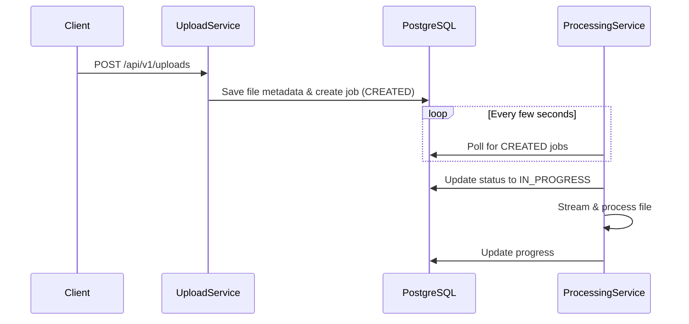

# API-Contract 
## This file documents the API contract for the CSV processing service. It defines the endpoints, request/response formats, and expected behaviors.


## The Upload API

`POST /api/v1/uploads`

### Request Body (multipart/form-data):
- file: The file to be uploaded (CSV file).

Response:
- 202 Accepted: File uploaded successfully. (The Upload API returns HTTP 202 Accepted because the file upload is
  accepted immediately, while processing continues asynchronously in the
  Processing Service.)
- 400 Bad Request: Invalid file format or missing file.

### Response Example :-

```json
{
  "jobId": "e7d3...",
  "status": "CREATED",
  "message": "File uploaded successfully."
}
```

## Get Job Status API

`GET /api/v1/jobs/{jobId}`

### Response : 
- 200 OK : for existing Job ID
- 404 Not Found : invalid Job ID
           

### Response Example :-
```json
{
    "jobId": "...",
    "status": "IN_PROGRESS",
    "processedRecords": 12350,
    "failedRecords": 12
}
```

## Future APIs

The following APIs are planned for future versions:

`GET /api/v1/jobs/{jobId}/errors`

Returns all invalid records encountered while processing.

`POST /api/v1/jobs/v1/{jobId}/retry`

Retries a failed processing job.

`DELETE /api/v1/jobs/{jobId}`

Deletes job metadata and associated processing information.

## Processing Service

The Processing Service does not expose public APIs in V1.

Instead, it discovers newly created jobs by polling the
processing_job table and processing them asynchronously.

This keeps long-running processing work separate from
user-facing HTTP requests.


## SEQUENCE DIAGRAM

